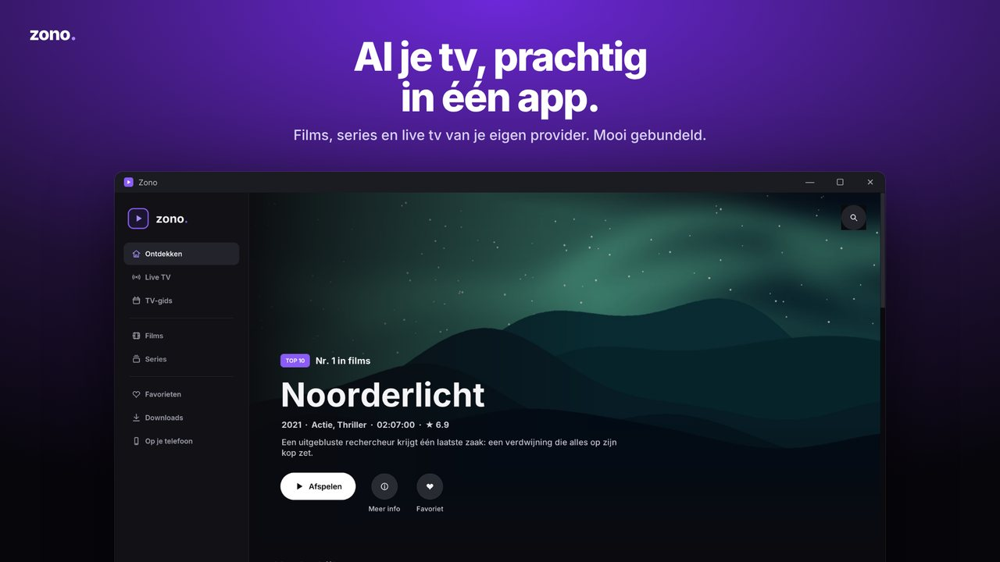
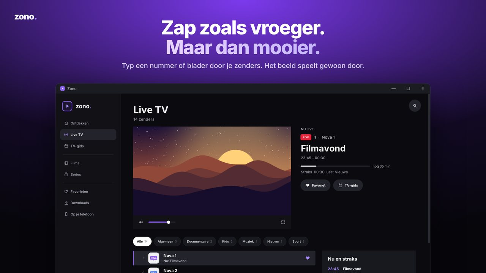
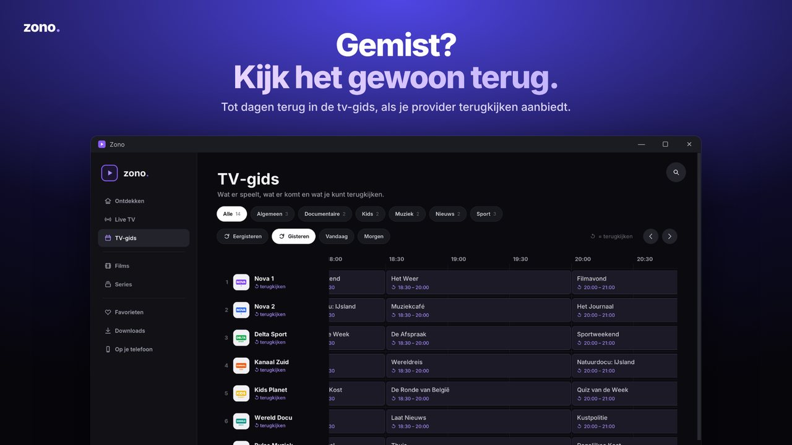

<p align="center"></p>

<p align="center"><a href="README.md">English</a> · <a href="README.nl.md">Nederlands</a> · <a href="README.fr.md">Français</a> · <b>Deutsch</b></p>

<p align="center"><b>Filme, Serien und Live-TV deines eigenen IPTV-Anbieters, vereint in einer Windows-App.</b></p>

<p align="center"></p>

Zono ist ein IPTV-Player für Windows 10 und 11 mit einer Oberfläche im Stil eines Streamingdienstes. Verbinde deinen eigenen Anbieter über Xtream Codes oder eine M3U-URL. Zono organisiert deine Inhalte in einer übersichtlichen Bibliothek mit einem integrierten Videoplayer auf Basis von VLC 3.

> Zono bietet keine Sender, Filme, Serien oder IPTV-Abonnements an. Du benötigst deinen eigenen Anbieter und bist dafür verantwortlich, dass du die angesehenen Inhalte rechtmäßig nutzen darfst.

## Funktionen

- **Entdecken**: Gestalte deine Startseite mit ein- und ausblendbaren Reihen, eigener Reihenfolge, großem Banner, Weiterschauen, Favoriten, Top 10, neuen Inhalten und Reihen nach Ländern.
- **Live-TV und Programmübersicht**: aktuelle und folgende Sendungen, vollständiger TV-Guide, zeitversetztes Fernsehen, sofern vom Anbieter unterstützt, und eine transparente Programmübersicht während der Wiedergabe.
- **Filme und Serien**: Detailseiten mit integrierten Trailern, Staffeln, Folgen und Markierungen für angesehene Inhalte.
- **Wiedergabesteuerung**: Countdown zur nächsten Folge, Intro überspringen, Untertitel einschließlich eigener `.srt`-Dateien, Tonspuren, Wiedergabegeschwindigkeit, Bild-in-Bild und Vollbild.
- **Aufnahme** von Live-TV über die rote R-Taste und **Downloads** zum Offline-Ansehen.
- **Multiview**: mehrere Sender gleichzeitig ansehen.
- **Auf dem Smartphone**: Scanne einen QR-Code, um über deinen PC auf iPhone oder Android zu schauen, einschließlich AirPlay-Unterstützung. Der PC wandelt Videos, die dein Smartphone nicht abspielen kann, in H.264 um.
- **Übertragung auf Fernseher** im Heimnetz über DLNA, darunter unterstützte LG-Modelle.
- **Profile** mit eigenen Favoriten, Wiedergabefortschritt, optionaler PIN und Kinderprofilen.
- **Bereinigte Titel**: Aus `[ALL] NL: Film (2024)` wird `Film`, aus `4K | VRT 1 HD` wird `VRT 1`; Trenneinträge des Anbieters werden entfernt.
- **Vier Sprachen**: Niederländisch, Französisch, Englisch und Deutsch. Zono übernimmt die Windows-Sprache; ändern kannst du sie unter Einstellungen › Allgemein › Sprache.
- Anbieterpasswörter werden mit Windows DPAPI verschlüsselt gespeichert.

<p align="center">
 
</p>

## Installation

Freigegebene Downloads erscheinen unter [Releases](../../releases). Die bereitgestellte Version 2.2.1 wurde noch nicht veröffentlicht: Die enthaltenen VLC-Module und ihre Lizenzbedingungen müssen zuerst geprüft werden. Deine Daten werden in `%LOCALAPPDATA%\Zono` gespeichert.

## Aus dem Quellcode starten

Für Entwickler unter Windows 10/11 (64 Bit):

1. Installiere **Python 3.12 (64 Bit)** und führe anschließend `pip install -r requirements.txt` aus.
2. Lege die VLC-Videoengine neben den Code: Kopiere `libvlc.dll`, `libvlccore.dll` und den Ordner `plugins` aus einer installierten **VLC-Version 3.0.x (64 Bit)** nach `src/video/`.
3. Starte die App mit `python src/app.py`.

Der Ordner `src/video/` ist in `.gitignore` ausgeschlossen; VLC ist nicht in diesem Repository enthalten.

## Tests

```bash
pip install -r requirements-dev.txt
python -m unittest discover -s tests -t .       # Testsuite
python -m pyflakes src tests tools              # statische Prüfung
python tools/perf.py                            # Leistung mit 56.000 Titeln
```

`ZONO_LANGUAGE=fr python -m unittest tests.test_ui_smoke` führt den App-Test in einer anderen Sprache aus und verwendet die Syntax einer POSIX-Shell.

Unter Linux laufen die Oberflächentests mit einem virtuellen Bildschirm: `xvfb-run -a python -m unittest discover -s tests -t .`. Ohne Bildschirm werden diese Tests übersprungen.

| Test | Geprüfte Bereiche |
|---|---|
| `test_countries` | Titelbereinigung, Ländererkennung, Folgentitel und Trenneinträge |
| `test_catalogue` | M3U-Verarbeitung, ausschließlich HTTP(S)-URLs, Xtream-Links, Ausblenden von Zugangsdaten und PINs |
| `test_qr` | QR-Codes zur Smartphone-Kopplung und Dekodierung, wenn `pyzbar` verfügbar ist |
| `test_remote` | Smartphone-Server: Zugangscodes, Bibliothek, Weiterleitung von Streams und Wiedergabelisten sowie Fehlermeldungen |
| `test_live_buffer` | Live-TV pausieren und zurückspulen: kombinierte Wiedergabeliste, Zeitfenster, Bereinigung und Aufnahme |
| `test_i18n` | Französische, englische und deutsche Übersetzungen mit übereinstimmenden `{}`-Platzhaltern |
| `test_images` | Laden von Postern von restriktiven Bildservern |
| `test_ui_smoke` | Startet die echte App mit simuliertem Player und Anbieter, besucht alle Seiten, spielt eine Folge und einen Sender ab und öffnet die Einstellungen; schlägt bei protokollierten Fehlern oder sich ansammelnden Timern fehl |

Der GitHub-Actions-Workflow (`.github/workflows/tests.yml`) führt die Prüfungen bei jedem Push unter Windows und Linux aus.

## Eine Version erstellen

`Zono.exe` ist ein kleiner Starter mit eingebettetem Python, Pillow und VLC sowie einer ZIP-Datei mit den Dateien aus `src/`. Für einen neuen Build wird diese ZIP-Datei in einer früheren Version ersetzt:

```bash
pip install pefile pillow
# 1. Setze VERSION in src/app.py auf die neue Version mit gleicher Zeichenlänge (z. B. 2.2.0 -> 2.2.1).
# 2. Erstelle den Build aus einer früheren Version mit Python 3.14, passend zur eingebetteten Laufzeit:
python tools/build_exe.py --base Zono-2_2_0.exe --old-version 2.2.0 --version 2.2.1 --python <pfad-zu-python3.14>
```

Die App wird als kompiliertes Python (`.pyc`) in die ausführbare Datei integriert, nicht als Klartext-Quellcode.

Das Ergebnis liegt in `dist/`. Informationen zum Aufbau findest du in [docs/ARCHITECTURE.md](docs/ARCHITECTURE.md). Ein erfolgreicher Build erfüllt nicht automatisch die nachfolgend beschriebenen Lizenzpflichten für Drittanbieterkomponenten.

## Übersetzung

Die Ausgangstexte sind auf Niederländisch verfasst und verwenden `T("…")`. Die Übersetzungen stehen in `src/locale/fr.json`, `en.json` und `de.json`. Führe nach dem Hinzufügen eines Textes `python tools/strings.py` aus, um fehlende Übersetzungen anzuzeigen.

## Lizenz

Der eigene Code von Zono steht unter der **[PolyForm Strict License 1.0.0](LICENSE.md)**. Zono ist **source available** (der Quellcode ist einsehbar), aber nicht Open Source nach der OSI-Definition. Zusammengefasst:

- Du darfst den Code **lesen** und Zono für die von der Lizenz erlaubten Zwecke nutzen, einschließlich nichtkommerzieller Nutzung. Die Lizenz enthält auch besondere Bestimmungen für nichtkommerzielle Organisationen.
- Die Lizenz erlaubt weder die Änderung von Zonos eigenem Code noch die Erstellung abgeleiteter Werke oder die Verbreitung von Kopien. Kommerzielle Nutzung oder Verkauf erfordern eine gesonderte Erlaubnis, soweit die Lizenz oder das geltende Recht dies nicht ausdrücklich gestatten.
- Bitte den Rechteinhaber um Erlaubnis, wenn du andere Nutzungen planst.

Der offizielle englische Lizenztext hat Vorrang vor dieser Zusammenfassung.

Software von Drittanbietern behält ihre eigenen Lizenzen; PolyForm Strict schränkt diese Rechte nicht ein. Siehe [THIRD_PARTY_NOTICES.md](THIRD_PARTY_NOTICES.md) und [NOTICE.md](NOTICE.md). Ein Lizenztext in einer ausführbaren Datei belegt für sich allein nicht, dass sämtliche Weitergabebedingungen erfüllt sind.
