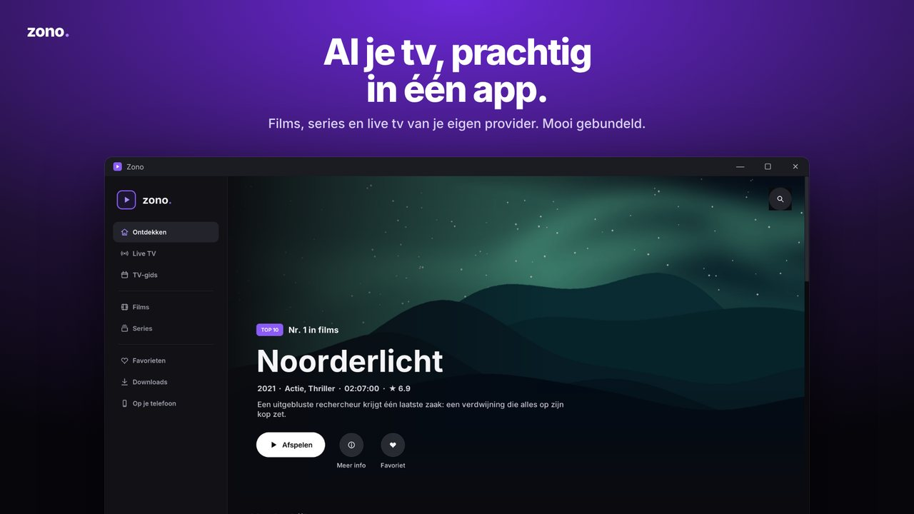
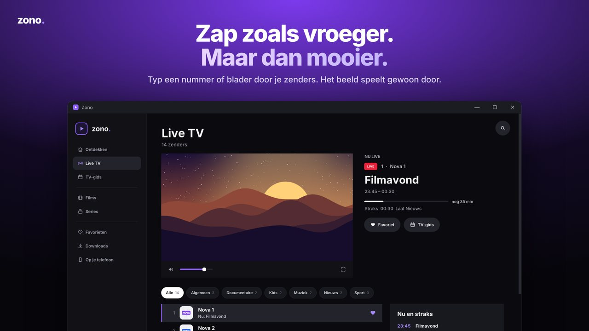
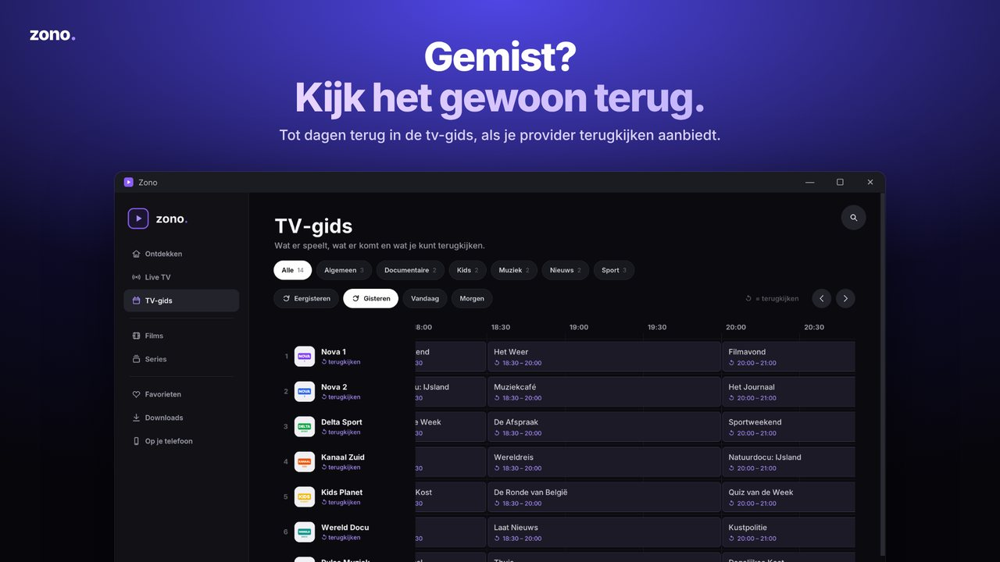

<p align="center"></p>

<p align="center"><a href="README.md">English</a> · <a href="README.nl.md">Nederlands</a> · <b>Français</b> · <a href="README.de.md">Deutsch</a></p>

<p align="center"><b>Films, séries et télévision en direct de votre propre fournisseur IPTV, réunis dans une application Windows.</b></p>

<p align="center"></p>

Zono est un lecteur IPTV pour Windows 10 et 11 doté d'une interface inspirée des services de streaming. Connectez votre propre fournisseur via Xtream Codes ou une URL M3U : Zono organise vos contenus dans une bibliothèque avec un lecteur vidéo intégré utilisant VLC 3.

> Zono ne fournit ni chaînes, ni films, ni séries, ni abonnements IPTV. Vous devez disposer de votre propre fournisseur et vous assurer que vous avez le droit d'accéder aux contenus que vous regardez.

## Fonctionnalités

- **Découvrir** : personnalisez l'accueil avec des rangées activables, leur ordre, une grande bannière, la reprise de lecture, les favoris, le top 10, les nouveautés et des sélections par pays.
- **TV en direct et guide des programmes** : programmes en cours et à suivre, guide complet, télévision de rattrapage si votre fournisseur la propose et guide transparent pendant la lecture.
- **Films et séries** : fiches détaillées avec bandes-annonces intégrées, saisons, épisodes et indicateurs de visionnage.
- **Commandes de lecture** : compte à rebours avant l'épisode suivant, passage du générique, sous-titres dont vos fichiers `.srt`, pistes audio, vitesse de lecture, image dans l'image et plein écran.
- **Enregistrement** de la TV en direct avec le bouton R rouge et **téléchargements** pour un visionnage hors ligne.
- **Multiview** : regardez plusieurs chaînes simultanément.
- **Sur votre téléphone** : scannez un code QR pour regarder sur iPhone ou Android via votre PC, avec prise en charge d'AirPlay. Le PC convertit en H.264 les vidéos que votre téléphone ne peut pas lire.
- **Diffusion sur les téléviseurs** du réseau domestique via DLNA, notamment les modèles LG compatibles.
- **Profils** avec favoris, progression, code PIN facultatif et profils enfants.
- **Titres simplifiés** : `[ALL] NL: Film (2024)` devient `Film`, `4K | VRT 1 HD` devient `VRT 1` et les entrées de séparation des fournisseurs sont supprimées.
- **Quatre langues** : néerlandais, français, anglais et allemand. Zono suit la langue de Windows ; vous pouvez la modifier dans Paramètres › Général › Langue.
- Les mots de passe du fournisseur sont stockés sous forme chiffrée avec Windows DPAPI.

<p align="center">
 
</p>

## Installation

Les téléchargements validés seront disponibles dans les [Releases](../../releases). La version 2.2.1 fournie n'a pas encore été publiée : les modules VLC inclus et leurs conditions de licence doivent d'abord être examinés. Vos données sont stockées dans `%LOCALAPPDATA%\Zono`.

## Exécuter depuis le code source

Pour les développeurs sous Windows 10/11 (64 bits) :

1. Installez **Python 3.12 (64 bits)**, puis exécutez `pip install -r requirements.txt`.
2. Placez le moteur vidéo VLC à côté du code : copiez `libvlc.dll`, `libvlccore.dll` et le dossier `plugins` d'une installation de **VLC 3.0.x (64 bits)** dans `src/video/`.
3. Exécutez `python src/app.py`.

Le dossier `src/video/` est exclu par `.gitignore` ; VLC n'est pas inclus dans ce dépôt.

## Tests

```bash
pip install -r requirements-dev.txt
python -m unittest discover -s tests -t .       # suite de tests
python -m pyflakes src tests tools              # analyse statique
python tools/perf.py                            # performances avec 56 000 titres
```

`ZONO_LANGUAGE=fr python -m unittest tests.test_ui_smoke` exécute le test de l'application dans une autre langue, avec la syntaxe d'un shell POSIX.

Sous Linux, utilisez un affichage virtuel pour les tests d'interface : `xvfb-run -a python -m unittest discover -s tests -t .`. Sans affichage, ces tests sont ignorés.

| Test | Vérifications |
|---|---|
| `test_countries` | Nettoyage des titres, détection des pays, titres d'épisodes et séparateurs |
| `test_catalogue` | Lecture M3U, URL HTTP(S) uniquement, liens Xtream, masquage des identifiants et codes PIN |
| `test_qr` | Codes QR d'association du téléphone et décodage si `pyzbar` est disponible |
| `test_remote` | Serveur du téléphone : codes d'accès, bibliothèque, relais des flux et listes de lecture, messages d'erreur |
| `test_live_buffer` | Pause et retour arrière en direct : liste de lecture combinée, fenêtre temporelle, nettoyage et enregistrement |
| `test_i18n` | Traductions françaises, anglaises et allemandes avec les mêmes paramètres `{}` |
| `test_images` | Chargement d'affiches depuis des serveurs d'images restrictifs |
| `test_ui_smoke` | Lance l'application réelle avec un lecteur et un fournisseur simulés, visite toutes les pages, lit un épisode et une chaîne et ouvre les paramètres ; échoue en cas d'erreurs journalisées ou d'accumulation de temporisateurs |

Le workflow GitHub Actions (`.github/workflows/tests.yml`) exécute ces vérifications sous Windows et Linux à chaque push.

## Construire une version

`Zono.exe` est un petit lanceur intégrant Python, Pillow et VLC, ainsi qu'une archive ZIP contenant les fichiers de `src/`. Une nouvelle version remplace cette archive dans une version antérieure :

```bash
pip install pefile pillow
# 1. Modifiez VERSION dans src/app.py en gardant la même longueur (ex. 2.2.0 -> 2.2.1).
# 2. Construisez à partir d'une version antérieure avec Python 3.14, identique au runtime intégré :
python tools/build_exe.py --base Zono-2_2_0.exe --old-version 2.2.0 --version 2.2.1 --python <chemin-vers-python3.14>
```

L'application est intégrée à l'exécutable sous forme de Python compilé (`.pyc`), et non de fichiers source en clair.

Les fichiers produits sont placés dans `dist/`. Consultez [docs/ARCHITECTURE.md](docs/ARCHITECTURE.md) pour l'architecture. Une compilation réussie ne règle pas les obligations de licence des composants tiers décrites ci-dessous.

## Traduction

Les textes sources sont en néerlandais et utilisent `T("…")`. Les traductions se trouvent dans `src/locale/fr.json`, `en.json` et `de.json`. Après l'ajout d'un texte, exécutez `python tools/strings.py` pour afficher les traductions manquantes.

## Licence

Le code propre à Zono est soumis à la **[PolyForm Strict License 1.0.0](LICENSE.md)**. Zono est **source available** (code source consultable), et non open source au sens de l'OSI. En résumé :

- Vous pouvez **lire** le code et utiliser Zono aux fins autorisées par la licence, notamment à des fins non commerciales. La licence prévoit également des dispositions spécifiques pour les organisations non commerciales.
- La licence n'autorise pas la modification du code propre à Zono, la création d'œuvres dérivées ou la distribution de copies. L'utilisation commerciale ou la vente nécessite une autorisation distincte, sauf permission expresse de la licence ou du droit applicable.
- Pour d'autres utilisations, demandez l'autorisation du propriétaire.

Le texte officiel anglais de la licence prévaut sur ce résumé.

Les logiciels tiers conservent leurs propres licences ; PolyForm Strict ne restreint pas ces droits. Consultez [THIRD_PARTY_NOTICES.md](THIRD_PARTY_NOTICES.md) et [NOTICE.md](NOTICE.md). La présence d'un texte de licence dans un exécutable ne garantit pas à elle seule le respect de toutes les obligations de distribution.
