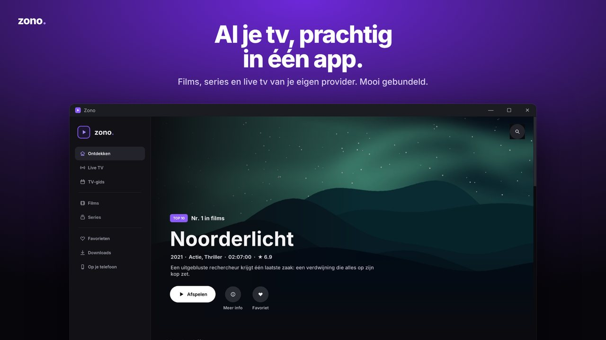
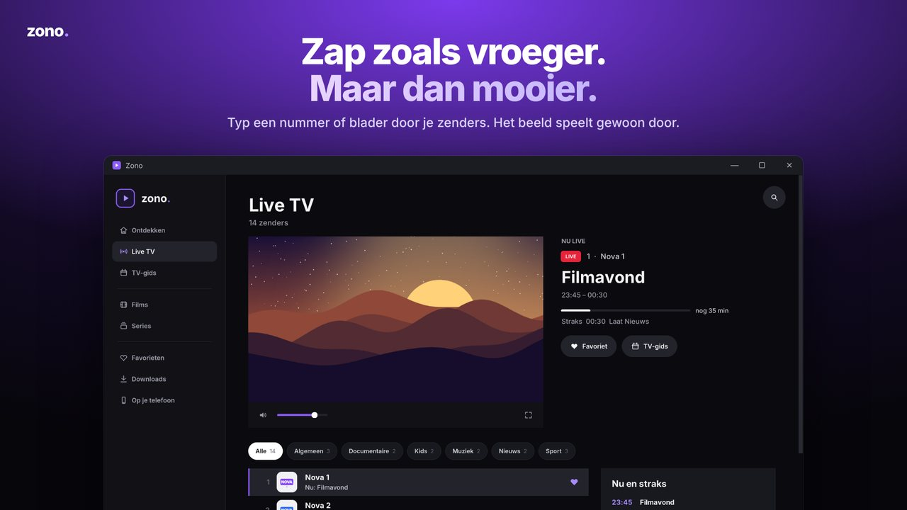
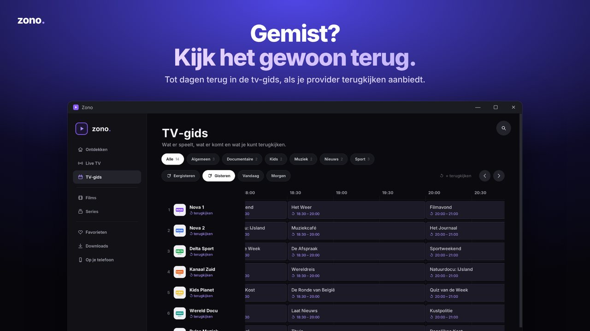

<p align="center"></p>

<p align="center"><b>English</b> · <a href="README.nl.md">Nederlands</a> · <a href="README.fr.md">Français</a> · <a href="README.de.md">Deutsch</a></p>

<p align="center"><b>Movies, series and live TV from your own IPTV provider, brought together in one Windows app.</b></p>

<p align="center"></p>

Zono is an IPTV player for Windows 10 and 11 with a streaming-service-style interface. Connect your own provider using Xtream Codes or an M3U URL, and Zono turns your content into an organised library with a built-in video player powered by VLC 3.

> Zono does not provide channels, movies, series or IPTV subscriptions. You need your own provider and are responsible for ensuring you have the right to access the content you watch.

## Features

- **Discover**: customise your home screen with optional rows, your preferred order, a large banner, Continue Watching, favourites, top 10, recently added content and rows by country.
- **Live TV and programme guide**: now/next information, a full TV guide, catch-up where supported by your provider, and a transparent guide while watching.
- **Movies and series**: detail pages with in-app trailers, seasons and episodes, and watched indicators.
- **Player controls**: next-episode countdown, skip intro, subtitles including your own `.srt` files, audio tracks, playback speed, picture-in-picture and full screen.
- **Recording** of live TV using the red R button, and **downloads** for offline viewing.
- **Multiview**: watch multiple channels at once.
- **Watch on your phone**: scan a QR code to watch on iPhone or Android through your PC, including AirPlay support. The PC converts video your phone cannot play to H.264.
- **Cast** to TVs on your home network using DLNA, including supported LG TVs.
- **Profiles** with separate favourites, progress, optional PINs and child profiles.
- **Clean titles**: `[ALL] NL: Film (2024)` becomes `Film`, `4K | VRT 1 HD` becomes `VRT 1`, and provider separator entries are removed.
- **Four languages**: Dutch, French, English and German. Zono follows your Windows language; you can change it under Settings › General › Language.
- Provider passwords are stored encrypted using Windows DPAPI.

<p align="center">
 
</p>

## Installation

Approved downloads will appear under [Releases](../../releases). The supplied 2.2.1 build has not been released yet: the bundled VLC modules and their licence terms must be reviewed first. Your data is stored in `%LOCALAPPDATA%\Zono`.

## Running from source

For developers on Windows 10/11 (64-bit):

1. Install **Python 3.12 (64-bit)**, then run `pip install -r requirements.txt`.
2. Place the VLC video engine alongside the code: copy `libvlc.dll`, `libvlccore.dll` and the `plugins` directory from an installed **VLC 3.0.x (64-bit)** into `src/video/`.
3. Run `python src/app.py`.

The `src/video/` directory is excluded by `.gitignore`; VLC is not included in this repository.

## Testing

```bash
pip install -r requirements-dev.txt
python -m unittest discover -s tests -t .       # test suite
python -m pyflakes src tests tools              # static checks
python tools/perf.py                            # performance with 56,000 titles
```

`ZONO_LANGUAGE=fr python -m unittest tests.test_ui_smoke` runs the app test in another language using POSIX shell syntax.

On Linux, run UI tests with a virtual display: `xvfb-run -a python -m unittest discover -s tests -t .`. Without a display, UI tests are skipped.

| Test | Coverage |
|---|---|
| `test_countries` | Title cleanup, country detection, episode titles and separator entries |
| `test_catalogue` | M3U parsing, HTTP(S)-only URLs, Xtream links, hiding credentials and PINs |
| `test_qr` | Phone-pairing QR codes and decoding when `pyzbar` is available |
| `test_remote` | Phone server: access codes, library, stream and playlist proxying, and error messages |
| `test_live_buffer` | Pausing and rewinding live TV: combined playlist, time window, cleanup and recording |
| `test_i18n` | French, English and German translations with matching `{}` placeholders |
| `test_images` | Loading posters from restrictive image servers |
| `test_ui_smoke` | Launches the real app with a fake player and provider, visits every page, plays an episode and a channel, and opens settings; fails on logged errors or accumulating timers |

The GitHub Actions workflow (`.github/workflows/tests.yml`) runs the checks on Windows and Linux for every push.

## Building a release

`Zono.exe` is a small launcher with embedded Python, Pillow and VLC, plus a ZIP containing the files from `src/`. A new build replaces that ZIP in an earlier release:

```bash
pip install pefile pillow
# 1. Set VERSION in src/app.py to the new version, keeping the same string length (e.g. 2.2.0 -> 2.2.1).
# 2. Build from a previous release using Python 3.14, matching the embedded runtime:
python tools/build_exe.py --base Zono-2_2_0.exe --old-version 2.2.0 --version 2.2.1 --python <path-to-python3.14>
```

The app is packaged as compiled Python (`.pyc`) inside the executable rather than plain source files.

### Publishing a release (auto-update)

Attach **two files** to a *published* (not draft) GitHub release whose tag is the version, e.g. `v2.3.0`:

- `Zono.exe`: installed Zono copies download this file to update themselves (checked against the SHA-256 GitHub publishes for it);
- `Zono.zip`: the same `Zono.exe` in a ZIP, used by the download buttons on zono.be (browsers block a bare unsigned `.exe` more often).

Write the release text with bullet lines per language; Zono's update panel and the "What's new" block on zono.be show the bullets in the user's language:

```
### NL
- 4K-zenders staan nu bovenaan
### FR
- Les chaînes 4K apparaissent en premier
### EN
- 4K channels now come first
### DE
- 4K-Sender stehen jetzt oben
```

Zono checks `https://api.github.com/repos/scoutr2019/zono/releases/latest` at startup, so publishing the release is all it takes. Versions 2.2.2 and older have no updater: those users download 2.3.0 once.

Build output is written to `dist/`. See [docs/ARCHITECTURE.md](docs/ARCHITECTURE.md) for the app's architecture. Building successfully does not resolve the third-party licensing requirements described below.

## Translation

Source strings are written in Dutch and wrapped in `T("…")`. Translations are stored in `src/locale/fr.json`, `en.json` and `de.json`. After adding a string, run `python tools/strings.py` to list missing translations.

## Licence

Zono's own code is licensed under the **[PolyForm Strict License 1.0.0](LICENSE.md)**. Zono is **source available**, not open source under the OSI definition. In plain language:

- You may **read** the code and use Zono for purposes allowed by the licence, including noncommercial use. The licence also contains specific provisions for noncommercial organisations.
- The licence does not grant permission to modify Zono's own code, create derivative works or distribute copies. Commercial use or sale requires separate permission unless expressly permitted by the licence or applicable law.
- For other uses, request permission from the owner.

The official English licence text takes precedence over this summary.

Third-party software retains its own licences; PolyForm Strict does not restrict those rights. See [THIRD_PARTY_NOTICES.md](THIRD_PARTY_NOTICES.md) and [NOTICE.md](NOTICE.md). Including a licence text in an executable does not, by itself, establish compliance with all distribution requirements.
