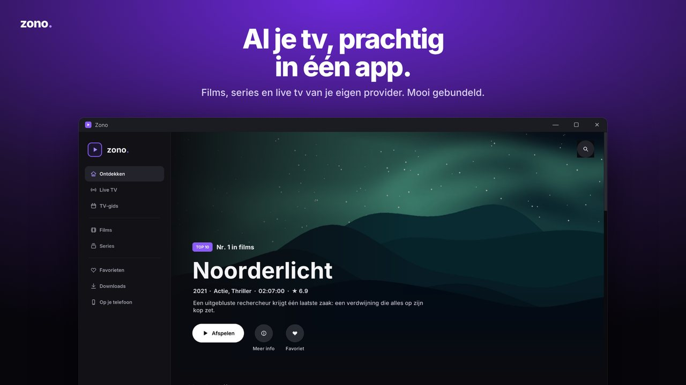
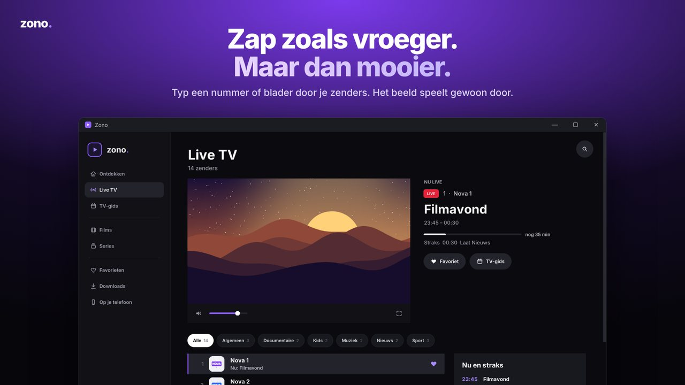
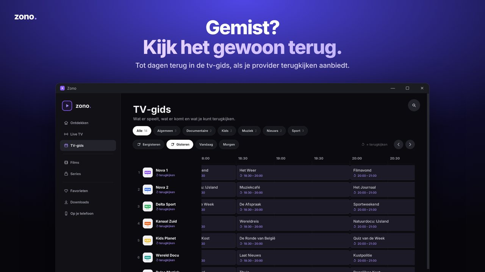

<p align="center"></p>

<p align="center"><a href="README.md">English</a> · <b>Nederlands</b> · <a href="README.fr.md">Français</a> · <a href="README.de.md">Deutsch</a></p>

<p align="center"><b>Films, series en live tv van je eigen IPTV-provider, mooi gebundeld in één Windows-app.</b></p>

<p align="center"></p>

Zono is een IPTV-speler voor Windows 10 en 11 in de stijl van een streamingdienst. Je koppelt je eigen provider (Xtream Codes of een M3U-link) en Zono maakt er een overzichtelijke bibliotheek van, met een ingebouwde videospeler (VLC 3).

> Zono levert zelf geen zenders, films of series. Je hebt een eigen abonnement bij een provider nodig en bent zelf verantwoordelijk voor wat je ermee bekijkt.

## Wat het kan

- **Ontdekken**: een startpagina die je zelf samenstelt (rijen aan/uit, volgorde, grote banner), met verder kijken, favorieten, top 10, nieuw toegevoegd en rijen per land.
- **Live TV en TV-gids**: zenderlijst met nu/straks, een volledige gids, terugkijken (catch-up) waar je provider dat aanbiedt, en een doorzichtige gids tijdens het kijken.
- **Films en series**: detailpagina's met trailer (in de app), seizoenen en afleveringen, vinkjes voor wat je gezien hebt.
- **Speler zoals Netflix**: volgende aflevering met aftelling, intro overslaan, ondertitels (ook eigen .srt), audiosporen, snelheid, picture-in-picture, volledig scherm.
- **Opnemen** van live tv (rode R-knop) en **downloads** voor offline kijken.
- **Multiview**: meerdere zenders tegelijk.
- **Op je telefoon**: scan een QR-code en kijk op je iPhone of Android (via de pc, ook met AirPlay); de pc zet beelden die de telefoon niet aankan om naar H.264.
- **Casten** naar tv's in huis (DLNA, o.a. LG).
- **Profielen** met eigen favorieten, voortgang en (optioneel) een pincode; kindprofielen.
- **Opgeruimde namen**: `[ALL] NL: Film (2024)` wordt `Film`, `4K | VRT 1 HD` wordt `VRT 1`, scheidingsregels van providers verdwijnen.
- **Vier talen**: Nederlands, Français, English en Deutsch. Zono volgt de taal van Windows en je kiest een andere bij Instellingen › Algemeen › Taal.
- Wachtwoorden van je provider worden met Windows (DPAPI) versleuteld bewaard.

<p align="center">
 
</p>

## Installeren

Goedgekeurde downloads verschijnen bij [Releases](../../releases). De aangeleverde build 2.2.1 is nog niet vrijgegeven: de meegeleverde VLC-modules en hun licentievoorwaarden moeten eerst worden gecontroleerd. Je gegevens staan in `%LOCALAPPDATA%\Zono`.

## Vanaf de broncode starten

Voor ontwikkelaars, op Windows 10/11 (64-bit):

1. Installeer **Python 3.12 (64-bit)** en daarna `pip install -r requirements.txt`.
2. Zet de VLC-videomotor naast de code: kopieer uit een geïnstalleerde **VLC 3.0.x (64-bit)** `libvlc.dll`, `libvlccore.dll` en de map `plugins` naar `src/video/`.
3. Start: `python src/app.py`.

De map `src/video/` staat in `.gitignore`: VLC zit niet in deze repository.

## Testen

```bash
pip install -r requirements-dev.txt
python -m unittest discover -s tests -t .       # alle tests
python -m pyflakes src tests tools              # code-controle
python tools/perf.py                            # snelheid met 56 000 titels
```

`ZONO_LANGUAGE=fr python -m unittest tests.test_ui_smoke` draait de app-test in een andere taal.

Op Linux draaien de UI-tests onder een virtueel scherm: `xvfb-run -a python -m unittest discover -s tests -t .`. Zonder scherm worden ze overgeslagen.

| Test | Wat wordt gecontroleerd |
|---|---|
| `test_countries` | Namen opschonen, landen herkennen, afleveringstitels, scheidingsregels |
| `test_catalogue` | M3U lezen, alleen http(s)-links, Xtream-links, verbergen van inloggegevens, pincodes |
| `test_qr` | QR-code voor de telefoonkoppeling (en ontcijferen, als `pyzbar` er is) |
| `test_remote` | Telefoonserver: toegangscode, bibliotheek, doorsturen van streams en playlists, foutuitleg |
| `test_live_buffer` | Pauzeren/terugspoelen bij live tv: samengevoegde playlist, venster, opruimen, opnemen |
| `test_i18n` | Elke tekst heeft een Franse, Engelse en Duitse vertaling met dezelfde `{}`-plekken |
| `test_images` | Posters laden ook van kieskeurige beeldservers |
| `test_ui_smoke` | Start de echte app (met een nep-videospeler en nep-provider), bezoekt elke pagina, speelt een aflevering en een zender af, opent instellingen; faalt bij elke fout in het logboek of bij oplopende timers |

De GitHub Actions-workflow (`.github/workflows/tests.yml`) draait dit bij elke push op Windows en Linux.

## Een release bouwen

`Zono.exe` is een kleine launcher met een ingebouwde Python, Pillow en VLC, plus een zip met de bestanden uit `src/`. Een nieuwe versie maak je door die zip in een eerdere release te vervangen:

```bash
pip install pefile pillow
# 1. zet VERSION in src/app.py op de nieuwe versie (even lang als de oude, bv. 2.2.0 -> 2.2.1)
# 2. bouw vanuit de vorige release, met Python 3.14 (dezelfde versie als in de exe):
python tools/build_exe.py --base Zono-2_2_0.exe --old-version 2.2.0 --version 2.2.1 --python <pad-naar-python3.14>
```

De app gaat als gecompileerde Python (`.pyc`) in de exe, niet als leesbare broncode.

Het resultaat staat in `dist/`. Zie [docs/ARCHITECTURE.md](docs/ARCHITECTURE.md) voor hoe de app in elkaar zit.

## Vertalen

Alle teksten staan in het Nederlands in de code, in `T("…")`. De vertalingen staan in `src/locale/fr.json`, `en.json` en `de.json`. Na een nieuwe tekst toont `python tools/strings.py` wat er nog vertaald moet worden.

## Licentie

De eigen code van Zono valt onder de **[PolyForm Strict License 1.0.0](LICENSE.md)**. Zono is **source available**, geen open source volgens de OSI-definitie. Dat betekent in gewone woorden:

- Je mag de code **lezen** en Zono gebruiken voor doeleinden die de licentie toestaat, waaronder niet-commercieel gebruik. De licentie bevat ook specifieke bepalingen voor niet-commerciële organisaties.
- De licentie geeft geen toestemming om de eigen code te wijzigen, afgeleide werken te maken of kopieën te verspreiden. Commercieel gebruik of verkoop vereist afzonderlijke toestemming, voor zover niet expliciet toegestaan door de licentie of toepasselijk recht.
- Wil je iets anders? Vraag toestemming aan de eigenaar.

Het officiële Engelse licentiebestand gaat altijd voor.

Software van derden behoudt altijd haar eigen licenties; PolyForm Strict beperkt die rechten niet. Zie [THIRD_PARTY_NOTICES.md](THIRD_PARTY_NOTICES.md) en [NOTICE.md](NOTICE.md). Het bestaan van een licentietekst in een exe is op zichzelf geen volledige controle van de distributievoorwaarden.
